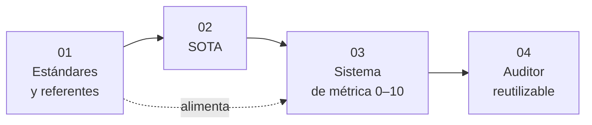

# WCAG Auditor

**Audita la accesibilidad de una web frente a WCAG y puntúala de 0 a 10.**
Un auditor reutilizable, reproducible y comparable.

[Documentación](./docs/README.md) · [Hoja de ruta](./ROUTEMAP.md) · [Changelog](./CHANGELOG.md) · [Reglas del proyecto](./AGENTS.md) · [Licencia](./LICENSE)

---

> ⚠️ **Fase de diseño (v0.1.0).** El repositorio contiene la estructura de trabajo y la documentación
> en construcción; **todavía no hay código ejecutable**. Lo que aparece como «previsto» describe el
> diseño, no algo que puedas ejecutar ya.

## Índice

- [Qué es](#qué-es)
- [Qué va a hacer](#qué-va-a-hacer)
- [Qué no hace](#qué-no-hace)
- [Familia de auditores](#familia-de-auditores)
- [Cómo será la nota 0–10](#cómo-será-la-nota-010)
- [Fases del proyecto](#fases-del-proyecto)
- [Flujo de contribución](#flujo-de-contribución)
- [Principios](#principios)
- [Licencia](#licencia)

## Qué es

**auditor-wcag** es un auditor de **accesibilidad web (WCAG)**. Evalúa si un sitio puede ser **percibido, operado y comprendido por todas las personas**, incluidas las que usan tecnologías de apoyo, midiendo el cumplimiento de los criterios de conformidad de WCAG.

Es trabajo de clase de la asignatura **Digitalización** (CIF La Laboral, 2º DAM vespertino, curso 2026-27) y está pensado para funcionar en [OpenCode](https://opencode.ai).

## Qué va a hacer

*(Alcance previsto; se confirmará y afinará en la fase 01, a partir de los estándares reales del área.)*

- Comprobación de criterios de conformidad WCAG (niveles A, AA y AAA) según los cuatro principios: perceptible, operable, comprensible y robusto.
- Detección automática de fallos y declaración de lo que requiere revisión manual.
- Contraste, alternativas textuales, estructura semántica y uso de teclado.
- Relación con la normativa aplicable (p. ej. EN 301 549 y la normativa española de accesibilidad).
- Informe de incumplimientos priorizados por nivel de conformidad e impacto.

## Qué no hace

Para no solapar trabajo, estas cuestiones pertenecen a otro auditor de la familia:

- la usabilidad general y la calidad de los flujos → [auditor-ux](https://github.com/Digital2DAMLaboral/auditor-ux).
- la calidad estética y la consistencia visual del diseño → [auditor-ui](https://github.com/Digital2DAMLaboral/auditor-ui).

## Familia de auditores

Tres auditores independientes que comparten estructura de trabajo y forma de puntuar:

| Auditor | Área | Qué evalúa |
|---|---|---|
| [auditor-ux](https://github.com/Digital2DAMLaboral/auditor-ux) | Experiencia de usuario (UX) | la usabilidad y la experiencia de uso de un producto digital |
| [auditor-ui](https://github.com/Digital2DAMLaboral/auditor-ui) | Interfaz de usuario (UI) | la calidad del diseño visual de una interfaz |
| [auditor-wcag](https://github.com/Digital2DAMLaboral/auditor-wcag) *(este repositorio)* | Accesibilidad web (WCAG) | la accesibilidad de una web frente a WCAG |

## Cómo será la nota 0–10

La métrica **no está fijada todavía**. La diseña el equipo en la fase 03 a partir de los estándares (fase 01) y del estado del arte (fase 02), y cada categoría, peso y umbral deberá justificarse con esas fuentes. Principios previstos:

- Una misma web auditada dos veces con la misma versión de la métrica da la **misma nota**.
- Lo que el auditor **no pueda medir** se declara como desconocido y **no penaliza**.
- Cada punto perdido se explica con evidencia: qué se comprobó, dónde y con qué resultado.

## Fases del proyecto

El trabajo se hace en [`docs/`](./docs/README.md) en **cuatro fases ordenadas**. Cada una se apoya en la anterior y se cierra con una versión. El detalle y los criterios de cierre están en la [hoja de ruta](./ROUTEMAP.md).

| Fase | Contenido | Versión | Estado |
|---|---|---|---|
| 01 | [Estándares y referentes](./docs/01-estandares-y-referentes/README.md) | 0.2.0 | ⬜ Pendiente |
| 02 | [SOTA (estado del arte)](./docs/02-sota/README.md) | 0.3.0 | ⬜ Pendiente |
| 03 | [Sistema de métrica 0–10](./docs/03-sistema-de-metrica/README.md) | 0.4.0 | ⬜ Pendiente |
| 04 | [Auditor reutilizable](./docs/04-auditor-reutilizable/README.md) | 0.5.0 y 0.6.0 | ⬜ Pendiente |

Versión actual: **0.1.0** (estructura base). Consulta el [CHANGELOG](./CHANGELOG.md).

### Fase 01 — Estándares y referentes

**Carpeta:** [`docs/01-estandares-y-referentes`](./docs/01-estandares-y-referentes/README.md) · **Versión objetivo:** 0.2.0 · **Estado:** ⬜ Pendiente

- **Objetivo:** Inventariar qué estándares, normas, guías y referentes existen en el área, con fuente primaria.
- **Entregables:**
  - `README.md` con el inventario: nombre, tipo (norma, estándar, guía, ley, herramienta), organismo, versión vigente, URL y fecha de consulta.
  - Una ficha por referente relevante (qué exige o propone, a quién aplica, qué parte es medible).
  - Criterio explícito de qué referentes se usarán en la métrica y cuáles se descartan, y por qué.
- **Se da por cerrada cuando:** Todo referente tiene URL de fuente primaria y fecha de consulta; el inventario cubre el área sin huecos evidentes; revisado por el profesor.

### Fase 02 — SOTA (estado del arte)

**Carpeta:** [`docs/02-sota`](./docs/02-sota/README.md) · **Versión objetivo:** 0.3.0 · **Estado:** ⬜ Pendiente

- **Objetivo:** Conocer qué se hace hoy en investigación y en herramientas para auditar esta área, y dónde están las carencias.
- **Entregables:**
  - Síntesis de investigación reciente (artículos, informes) con cita completa y fecha.
  - Comparativa de herramientas y auditores existentes: qué miden, cómo puntúan, límites.
  - Carencias y oportunidades que justifican decisiones de la métrica y del auditor.
- **Se da por cerrada cuando:** Cada afirmación enlaza a su fuente; la comparativa de herramientas es verificable; las carencias identificadas se pueden trazar a decisiones posteriores.

### Fase 03 — Sistema de métrica 0–10

**Carpeta:** [`docs/03-sistema-de-metrica`](./docs/03-sistema-de-metrica/README.md) · **Versión objetivo:** 0.4.0 · **Estado:** ⬜ Pendiente

- **Objetivo:** Diseñar la métrica de puntuación de 0 a 10 a partir de las fases 01 y 02.
- **Entregables:**
  - Categorías y checks, con qué referente (01) o hallazgo (02) justifica cada uno.
  - Pesos, umbrales y topes, cada uno justificado.
  - Tratamiento de lo no medible (`unknown` no penaliza) y de lo que requiere revisión manual.
  - Al menos un ejemplo de cálculo resuelto de principio a fin y reproducible.
  - Versión de la métrica y regla para cambiarla.
- **Se da por cerrada cuando:** Cada decisión es trazable a 01 o 02; el ejemplo da siempre la misma nota; se hizo un premortem antes de fijar pesos; revisado por el profesor.

### Fase 04 — Auditor reutilizable

**Carpeta:** [`docs/04-auditor-reutilizable`](./docs/04-auditor-reutilizable/README.md) · **Versión objetivo:** 0.5.0 (requisitos y análisis) y 0.6.0 (diseño) · **Estado:** ⬜ Pendiente

- **Objetivo:** Definir y diseñar el auditor que aplica la métrica de forma reutilizable sobre cualquier sitio.
- **Entregables:**
  - `requisitos-analisis.md`: actores, casos de uso, requisitos funcionales y no funcionales, entradas y salidas, límites y riesgos.
  - `diseno.md`: arquitectura y flujo de una auditoría con diagramas Mermaid, formato del informe, agentes y skills de OpenCode, plan de pruebas.
- **Se da por cerrada cuando:** Cada requisito se traza a la métrica (03); el diseño cubre todos los requisitos; no hay decisiones sin justificar; revisado por el profesor.

## Flujo de contribución

`main` estará protegida: no se empuja ni se mergea directamente. Cada persona trabaja en su rama.

1. `git switch -c <tipo>/<descripcion-corta>` (p. ej. `docs/estandares-referentes`).
2. Commits con [Conventional Commits](https://www.conventionalcommits.org/es/v1.0.0/) (`docs:`, `feat:`, `fix:`…).
3. `git push -u origin <tu-rama>` y abre una Pull Request hacia `main`.
4. El profesor revisa y hace el merge.

Las reglas completas del proyecto están en [`AGENTS.md`](./AGENTS.md).

## Principios

- **Evidencia sobre declaración:** toda afirmación lleva fuente y fecha de consulta.
- **`unknown` no es fallo:** lo no medible se declara y no penaliza.
- **Privacidad por defecto:** sin tracking de usuarios finales y sin secretos en el repositorio.
- Documentación en español y diagramas en Mermaid.

## Licencia

[MIT](./LICENSE) © 2026 Alumnado y profesorado de 2º DAM (turno vespertino), CIF La Laboral — curso 2026-27.
