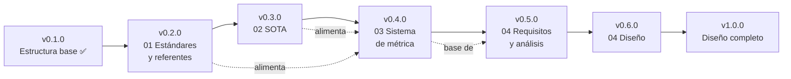

# ROUTEMAP — auditor-wcag

Hoja de ruta de **auditor-wcag** (accesibilidad web (WCAG)). Cada hito corresponde a una versión y a una fase de [`docs/`](./docs/README.md). Las fases se hacen **en orden**: no se abre una sin cerrar la anterior.

> No hay fechas comprometidas: el calendario lo marca el curso. Lo que sí es fijo es el orden y el criterio de cierre de cada hito.

## Vista general

## Hitos

| Versión | Hito | Fase | Estado |
|---|---|---|---|
| 0.1.0 | Estructura base, README, AGENTS, licencia | — | ✅ Hecho (2026-10-14) |
| 0.2.0 | Estándares y referentes cerrados | [01](./docs/01-estandares-y-referentes/README.md) | ⬜ Pendiente |
| 0.3.0 | Estado del arte cerrado | [02](./docs/02-sota/README.md) | ⬜ Pendiente |
| 0.4.0 | Sistema de métrica 0–10 cerrado | [03](./docs/03-sistema-de-metrica/README.md) | ⬜ Pendiente |
| 0.5.0 | Requisitos y análisis del auditor | [04](./docs/04-auditor-reutilizable/requisitos-analisis.md) | ⬜ Pendiente |
| 0.6.0 | Diseño del auditor | [04](./docs/04-auditor-reutilizable/diseno.md) | ⬜ Pendiente |
| 1.0.0 | Diseño completo, coherente y revisado | 01–04 | ⬜ Pendiente |

## Detalle por fase

### Fase 01 — Estándares y referentes (v0.2.0)

**Objetivo:** Inventariar qué estándares, normas, guías y referentes existen en el área, con fuente primaria.

**Entregables:**

- `README.md` con el inventario: nombre, tipo (norma, estándar, guía, ley, herramienta), organismo, versión vigente, URL y fecha de consulta.
- Una ficha por referente relevante (qué exige o propone, a quién aplica, qué parte es medible).
- Criterio explícito de qué referentes se usarán en la métrica y cuáles se descartan, y por qué.

**Criterio de cierre:** Todo referente tiene URL de fuente primaria y fecha de consulta; el inventario cubre el área sin huecos evidentes; revisado por el profesor.

### Fase 02 — SOTA (estado del arte) (v0.3.0)

**Objetivo:** Conocer qué se hace hoy en investigación y en herramientas para auditar esta área, y dónde están las carencias.

**Entregables:**

- Síntesis de investigación reciente (artículos, informes) con cita completa y fecha.
- Comparativa de herramientas y auditores existentes: qué miden, cómo puntúan, límites.
- Carencias y oportunidades que justifican decisiones de la métrica y del auditor.

**Criterio de cierre:** Cada afirmación enlaza a su fuente; la comparativa de herramientas es verificable; las carencias identificadas se pueden trazar a decisiones posteriores.

### Fase 03 — Sistema de métrica 0–10 (v0.4.0)

**Objetivo:** Diseñar la métrica de puntuación de 0 a 10 a partir de las fases 01 y 02.

**Entregables:**

- Categorías y checks, con qué referente (01) o hallazgo (02) justifica cada uno.
- Pesos, umbrales y topes, cada uno justificado.
- Tratamiento de lo no medible (`unknown` no penaliza) y de lo que requiere revisión manual.
- Al menos un ejemplo de cálculo resuelto de principio a fin y reproducible.
- Versión de la métrica y regla para cambiarla.

**Criterio de cierre:** Cada decisión es trazable a 01 o 02; el ejemplo da siempre la misma nota; se hizo un premortem antes de fijar pesos; revisado por el profesor.

### Fase 04 — Auditor reutilizable (v0.5.0 (requisitos y análisis) y 0.6.0 (diseño))

**Objetivo:** Definir y diseñar el auditor que aplica la métrica de forma reutilizable sobre cualquier sitio.

**Entregables:**

- `requisitos-analisis.md`: actores, casos de uso, requisitos funcionales y no funcionales, entradas y salidas, límites y riesgos.
- `diseno.md`: arquitectura y flujo de una auditoría con diagramas Mermaid, formato del informe, agentes y skills de OpenCode, plan de pruebas.

**Criterio de cierre:** Cada requisito se traza a la métrica (03); el diseño cubre todos los requisitos; no hay decisiones sin justificar; revisado por el profesor.

## Fuera de alcance por ahora

La **implementación** del auditor (código, CLI, interfaz) no forma parte de este mapa. Se planificará cuando el diseño (v1.0.0) esté cerrado y revisado.

## Cómo se cierra un hito

1. Todos los entregables de la fase existen en `docs/` y cumplen el criterio de cierre.
2. Pull Request revisada y mergeada por el profesor.
3. Se actualiza [`CHANGELOG.md`](./CHANGELOG.md), el estado de esta tabla y el del [`README.md`](./README.md).
4. Se crea la etiqueta de versión (`vX.Y.Z`).
